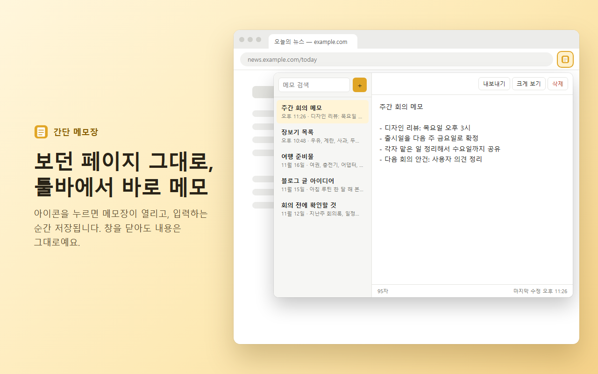

# 간단 메모장

툴바에서 바로 여는 Chrome 메모장 확장 프로그램입니다. 메모는 자동 저장되고, 사용 중인 기기의 브라우저 안에만 보관됩니다.



## 기능

- 여러 개의 메모 (첫 줄이 제목)
- 입력 즉시 자동 저장
- 전체 메모 본문 검색 (`Ctrl+F`)
- 새 메모 (`＋` 버튼 또는 `Alt+N`)
- 현재 메모를 `.txt` 파일로 내보내기
- 새 탭에서 크게 보기
- 운영체제 설정에 맞춘 다크 모드
- 두 번 눌러야 지워지는 삭제 버튼

## 설치 (개발용)

1. 이 저장소를 내려받습니다.
2. Chrome 주소창에 `chrome://extensions`를 입력합니다.
3. 오른쪽 위의 **개발자 모드**를 켭니다.
4. **압축해제된 확장 프로그램을 로드합니다**를 누르고 이 폴더를 선택합니다.

## 권한과 개인정보

요청하는 권한은 `storage` 하나뿐입니다. 작성한 메모를 이 기기에 저장하는 데만 쓰며, 메모는 어떤 서버로도 전송되지 않습니다.
자세한 내용은 [개인정보처리방침](docs/privacy-policy.html)을 참고하세요.

## 폴더 구조

| 경로 | 내용 |
|------|------|
| `manifest.json`, `popup/`, `icons/` | 확장 프로그램 본체 |
| `docs/` | GitHub Pages로 공개되는 개인정보처리방침 |
| `store-assets/` | 스토어 스크린샷·프로모션 이미지와 생성 스크립트 |
| `scripts/package.py` | 스토어 업로드용 ZIP 생성 |
| `CHROMEWEBSTORE.md` | 스토어 등록 정보, 권한 사유, 버전 기록 |

## 스토어 업로드 파일 만들기

```bash
python scripts/package.py
```

`dist/simple-memo-v<버전>.zip`이 만들어집니다. 스크린샷을 다시 만들려면 `python store-assets/build_assets.py`를 실행합니다.

## 문의

에릭 · movement2230@gmail.com
