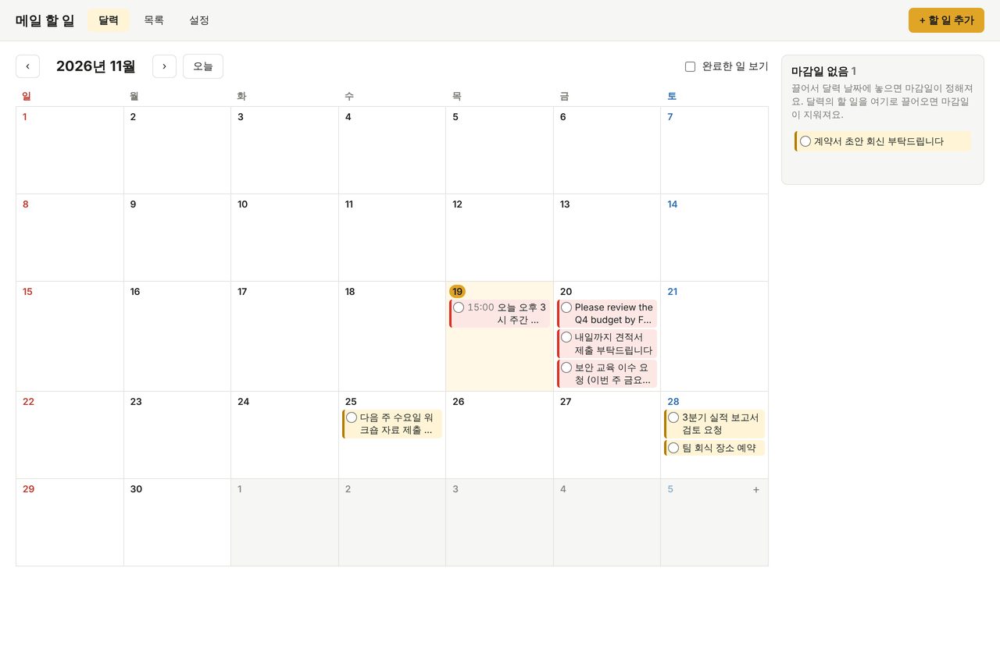

# 메일 할 일

메일 목록의 **제목만** 읽어 할 일과 마감일을 자동으로 만들고, 달력에서 확인·수정할 수 있는 Chrome·Edge 확장 프로그램입니다.
메일 본문은 읽지 않고, 어떤 서버로도 데이터를 보내지 않습니다. 할 일은 이 브라우저 안에만 저장됩니다.



## 기능

- **어떤 메일함이든**: 사내 그룹웨어, Gmail, Outlook 웹 등 브라우저로 여는 메일함이면 됩니다.
  - 자동 인식: Gmail 전용 인식과, 이름에 `subject`/`title`이 들어간 목록을 찾는 일반 인식
  - 자동으로 못 찾으면 **목록 직접 지정**을 누르고 메일 제목 하나만 클릭하면 됩니다(메일함마다 한 번).
- **메일함 구분**: 할 일마다 어느 메일함에서 왔는지 색 점과 이름으로 표시합니다.
  - 구글(`mail.google.com`)·네이버(`mail.naver.com`)는 이름과 색이 자동으로 붙고, 그 밖의 메일함은 "사내"로 시작합니다.
  - 이름과 색은 설정 탭이나 팝업에서 바꿀 수 있습니다(예: 사내 메일함이 둘이면 "본사", "그룹사").
  - 달력·목록 위의 메일함 버튼을 눌러 특정 메일함의 할 일만 골라 볼 수 있습니다.
  - 직접 추가한 할 일은 "직접 추가"로 표시되고, 편집 창에서 메일함을 고를 수 있습니다.
- **할 일 판단**(PC 안에서만): "요청, 검토, 회신, 제출, 결재…" 같은 단어와 마감 표현을 찾습니다.
  - 날짜: `11/25`, `11월 25일`, `2026-12-03`, `25일까지`, `오늘/금일`, `내일`, `모레`, `D-3`, `3일 이내`, `금요일까지`, `이번 주 금요일`, `다음 주 수요일`, `차주 중`, `이번 달 말`, `by Friday`, `EOD`
  - 시간: `오후 3시`, `10시 반`, `15:00`
  - 우선순위: `긴급`, `중요`, `ASAP`이 있거나 마감이 하루 안이면 '높음'
  - 광고·뉴스레터·영수증은 제외
  - `RE:`, `FW:`, `[외부]`는 떼고, 같은 스레드는 하나로 묶습니다.
  - 판단 단어는 설정에서 직접 고칠 수 있습니다.
- **달력**: 월 단위로 마감일에 할 일을 표시합니다.
  - 끌어다 놓아 마감일 변경
  - 날짜 칸의 `+`로 할 일 추가
  - 동그라미를 눌러 완료
- **수정**: 할 일 문장, 마감일, 시간, 우선순위, 메모, 완료를 고칠 수 있습니다. 원래 메일 제목과 메일 링크가 함께 보입니다.
- **목록**: 지난 마감 / 오늘 / 7일 안 / 나중에 / 마감일 없음 / 완료로 묶어 보여 주고, 검색할 수 있습니다.
- **툴바 배지**: 오늘까지(지난 것 포함) 못 끝낸 할 일 수
- **브라우저 내장 AI(선택)**: Chrome(Gemini Nano)이나 Edge(Phi-4-mini 등)의 내장 AI가 있으면 할 일 문장과 마감일을 다듬습니다.
  - PC 안에서만 돌아가는 모델이라 메일 제목이 외부로 나가지 않습니다.
  - 없으면 규칙만으로 동작합니다.
  - 사용자가 직접 고친 할 일은 건드리지 않습니다.
- **백업**: JSON 파일로 내보내기와 가져오기를 할 수 있습니다.

## 설치

1. `mail-todo-v<버전>.zip`의 압축을 풉니다. Windows에서는 파일을 오른쪽 클릭한 뒤 **압축 풀기**를 누르면 됩니다. 이 폴더는 설치 뒤에도 지우지 말고 그대로 두세요.
2. 주소창에 `chrome://extensions`(Edge는 `edge://extensions`)를 입력합니다.
3. **개발자 모드**를 켭니다.
4. **압축해제된 확장 프로그램을 로드합니다**를 누르고, 압축을 푼 폴더(`manifest.json`이 들어 있는 폴더)를 선택합니다.

새 버전으로 바꿀 때는 새 zip의 압축을 같은 폴더에 덮어쓰고, 확장 프로그램 페이지에서 **새로고침(↻)**을 누르세요. 할 일 데이터는 그대로 남습니다.

### zip 만들기

```bash
python mail-todo/package.py
```

`mail-todo/dist/mail-todo-v<버전>.zip`이 만들어집니다. 실행에 필요한 파일만 담기고, 빠진 파일이 없는지도 검사합니다.

## 사용법

1. 메일함 페이지를 엽니다.
2. 툴바의 **메일 할 일** 아이콘을 누르고 **이 메일함에서 켜기**를 누릅니다. 브라우저가 이 사이트 접근 권한을 물으면 허용합니다.
3. 목록에 보이는 메일 제목을 바로 읽고, 새 메일이 오거나 페이지를 넘기면 자동으로 다시 읽습니다.
4. "제목을 찾지 못했어요"가 나오면 **목록 직접 지정**을 누르고 메일 제목 하나를 클릭합니다.
5. **달력 열기**에서 할 일을 확인하고 고칩니다.

> 회사 PC는 승인되지 않은 확장 프로그램 설치를 막아 두기도 합니다. 그럴 때는 IT 담당자에게 문의하세요. 이 확장 프로그램은 외부 서버가 없고, 사용자가 켠 메일 사이트에만 접근합니다.

## 권한

| 권한 | 쓰는 곳 |
|------|---------|
| `storage` | 할 일·설정을 이 브라우저에 저장 |
| `activeTab` | 팝업을 연 탭이 어떤 사이트인지 확인 |
| `scripting` | 사용자가 켠 메일 사이트에만 제목 읽기 스크립트 등록 |
| 사이트 접근(선택) | **켜기**를 누른 메일 사이트에만, 그때 따로 요청 |

## 한계

- 제목만 읽기 때문에 본문에만 적힌 마감일은 알 수 없습니다. 이럴 때는 할 일을 눌러 마감일을 직접 넣어 주세요.
- 연도 없는 날짜(`11/25`)는 올해로 봅니다. 60일 넘게 지난 날짜면 내년으로 봅니다.
- `오늘`, `내일` 같은 상대 날짜는 메일을 받은 날이 아니라 **확장 프로그램이 처음 읽은 날**을 기준으로 계산합니다.
- 이미 읽은 메일에는 바뀐 규칙이 적용되지 않습니다. 다시 적용하려면 설정의 **처리 기록 초기화**를 누르세요.

## 폴더 구조

| 경로 | 내용 |
|------|------|
| `manifest.json`, `icons/` | 확장 프로그램 정보 |
| `src/rules.js` | 할 일·마감일 판단 규칙 |
| `src/content.js` | 메일 목록에서 제목만 읽기, 목록 직접 지정 |
| `src/background.js` | 저장, 중복 제거, 사이트 켜기/끄기, 배지 |
| `src/mailboxes.js` | 메일함 이름·색 |
| `src/ai.js` | 브라우저 내장 AI(선택) |
| `pages/` | 팝업, 달력·목록·설정 화면 |
| `tests/` | 규칙 테스트, 실제 브라우저 테스트 |
| `package.py` | 설치용 zip 만들기 |

## 테스트

```bash
node --test mail-todo/tests/rules.test.mjs
```

날짜·키워드 판단 규칙을 점검합니다.

```bash
node mail-todo/tests/browser-test.mjs
```

실제 Chromium에 확장 프로그램을 올리고, 가짜 메일함 4종(그룹웨어형, Gmail형, 네이버 메일형, 클래스 이름이 무작위인 메일함)에서 다음을 점검합니다.

- 제목 읽기, 새 메일 자동 감지, 목록 직접 지정
- 달력 표시, 끌어서 날짜 바꾸기, 수정, 완료, 추가, 삭제
- 메일함 이름·색 자동 지정, 메일함별 골라 보기, 이름 바꾸기
- 규칙 변경, 팝업, 배지

Playwright가 필요합니다(`npm i -D playwright`). 결과와 스크린샷은 `mail-todo/test-results/`에 저장됩니다.
